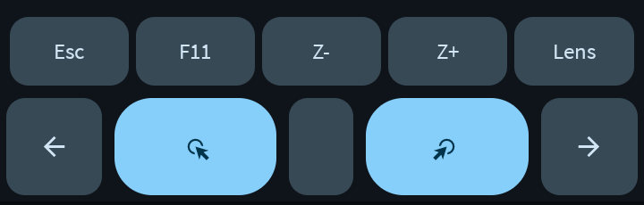

# KDE Connect - Android app

> **About this fork (branch `remote-back-forward-zoom-lens`)**
>
> This is an unofficial fork of KDE Connect for Android. It adds extra buttons to the
> **Remote input** screen. Everything else is the same as upstream KDE Connect.
> See [Extra Remote input buttons](#extra-remote-input-buttons-this-fork) below for
> what the buttons do and the PC setup that zoom and lens need.

KDE Connect is a multi-platform app that allows your devices to communicate (eg: your phone and your computer).

## Extra Remote input buttons (this fork)



The top row and the two outer buttons of the bottom row are new. The light blue buttons
(left and right click) and the small middle button (middle click) are standard KDE Connect.

### What the buttons do

| Label on screen | Button | Keys sent to the PC | Needs PC setup? |
|---|---|---|---|
| ← | Back | Alt+Left | No |
| → | Forward | Alt+Right | No |
| Esc | Escape | Escape | No |
| F11 | Full screen | F11 | No |
| Z- | Zoom out | Alt+Super+Minus | Depends on desktop (see below) |
| Z+ | Zoom in | Alt+Super+Equals | Depends on desktop (see below) |
| Lens | Lens toggle | Alt+Super+8 | Yes on Cinnamon (see below) |

The Back, Forward, Esc and F11 buttons work with any desktop and need no setup.
The same four buttons are also offered upstream on the `browser-back-forward` branch.

The zoom and lens buttons only send keyboard shortcuts. The actual zooming is done by
your desktop's built-in screen magnifier, so the desktop must have those shortcuts set up.

### PC setup on Linux Mint (Cinnamon)

Tested on Linux Mint 22 with Cinnamon 6.

1. **Install KDE Connect on the PC** and pair it with your phone as usual.
   In the PC's KDE Connect settings for your phone, make sure the plugin that
   receives remote mouse and keyboard input is enabled.

2. **Zoom in and Zoom out work out of the box.** Cinnamon already uses
   Alt+Super+Equals and Alt+Super+Minus for its magnifier. You can check this in
   *System Settings > Keyboard > Shortcuts > Universal Access*.

3. **Choose how zoom looks.** Open *System Settings > Accessibility > Visual*, find
   the zoom section, and set the options you like. For a magnifying "lens" that follows
   the pointer instead of zooming the whole screen, turn on **Lens mode** and pick a
   lens shape (for example square). Mouse tracking "proportional" works well.

4. **Add the Lens toggle shortcut.** Cinnamon has no built-in shortcut to switch zoom
   on and off, so this fork includes a small script for it,
   [`contrib/toggle-zoom.sh`](contrib/toggle-zoom.sh).

   a. Copy the script to your computer and make it runnable:

   ```bash
   mkdir -p ~/.local/bin && cp contrib/toggle-zoom.sh ~/.local/bin/ && chmod +x ~/.local/bin/toggle-zoom.sh
   ```

   b. Open *System Settings > Keyboard > Shortcuts*, choose **Add custom shortcut**,
      name it `toggle zoom`, and for the command enter the full path, for example
      `/home/YOUR-USER-NAME/.local/bin/toggle-zoom.sh`.

   c. Click the new shortcut's empty binding and press **Alt+Super+8**.

5. **Test it on the PC first.** Press Alt+Super+8 on the PC keyboard; zoom should switch
   on. Press Alt+Super+Equals and Alt+Super+Minus to zoom in and out. If this works on
   the keyboard, it will work from the phone.

### Other desktops

- **GNOME:** the defaults already match (Alt+Super+8 toggles zoom, Alt+Super+Equals and
  Alt+Super+Minus zoom in and out). Turn on zoom options in *Settings > Accessibility*.
  No script needed.
- **KDE Plasma:** Plasma's zoom uses different default shortcuts (Meta+Equals and
  Meta+Minus). In *System Settings > Shortcuts > KWin*, set the Zoom In and Zoom Out
  shortcuts to Alt+Meta+Equals and Alt+Meta+Minus. Plasma has no simple on/off toggle,
  so the Lens toggle button may do nothing there. Not tested.
- **Windows and macOS:** not tested.

### Installing this fork on your phone

This fork is not on the Play Store or F-Droid; you build it yourself. With the Android SDK
installed, run this in the project folder:

```bash
./gradlew assembleDebug
```

The app is created at `build/outputs/apk/debug/kdeconnect-android-debug.apk`. Copy it to
your phone (for example with KDE Connect's "Share file") and open it to install.
The debug build installs **next to** the official KDE Connect app instead of replacing it,
so you need to pair it with your PC once.

## (Some) Features
- **Shared clipboard**: copy and paste between your phone and your computer (or any other device).
- **Notification sync**: Read and reply to your Android notifications from the desktop.
- **Share files and URLs** instantly from one device to another.
- **Multimedia remote control**: Use your phone as a remote for Linux media players.
- **Virtual touchpad**: Use your phone screen as your computer's touchpad and keyboard.

All this without wires, over the already existing Wi-Fi network, and using TLS encryption.

## About this app

This is a native Android port of the KDE Connect Qt app. You will find a more complete readme about KDE Connect [here](https://invent.kde.org/network/kdeconnect-kde/).

## How to install this app

You can install this app from the [Play Store](https://play.google.com/store/apps/details?id=org.kde.kdeconnect_tp) as well as [F-Droid](https://f-droid.org/repository/browse/?fdid=org.kde.kdeconnect_tp). Note you will also need to install the [desktop app](https://invent.kde.org/network/kdeconnect-kde) for it to work.

## Contributing

A lot of useful information, including how to get started working on KDE Connect and how to connect with the current developers, is on our [KDE Community Wiki page](https://community.kde.org/KDEConnect)

For bug reporting, please use [KDE's Bugzilla](https://bugs.kde.org). Please do not use the issue tracker in GitLab since we want to keep everything in one place.

To contribute patches, use [KDE Connect's Gitlab](https://invent.kde.org/network/kdeconnect-android/).
On Gitlab (as well as on our [old Phabricator](https://phabricator.kde.org/tag/kde_connect/)) you can find a task list with stuff to do and links to other relevant resources.
It is a good idea to also subscribe to the [KDE Connect mailing list](https://mail.kde.org/mailman/listinfo/kdeconnect).

Please know that all translations for all KDE apps are handled by the [localization team](https://l10n.kde.org/). If you would like to submit a translation, that should be done by working with the proper team for that language.

## License
[GNU GPL v2](https://www.gnu.org/licenses/gpl-2.0.html) and [GNU GPL v3](https://www.gnu.org/licenses/gpl-3.0.html)

If you are reading this from GitHub, you should know that this is just a mirror of the [KDE Project repo](https://invent.kde.org/network/kdeconnect-android/).
